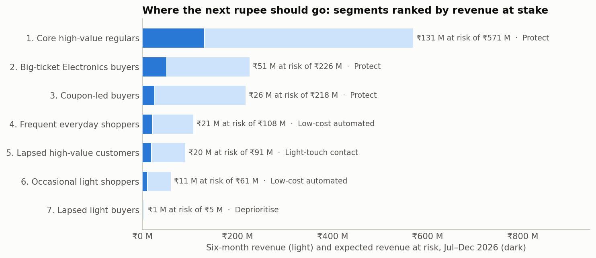

<h1 align="center">
Segment Playbook
</h1>

<b>Where the next rupee of retention and marketing spend should go, and how to prove it worked</b>

This playbook answers Objective 6 of the [analysis charter](../02_documentation/analysis_charter.md). Every figure comes from a notebook in this repository or from the first project's report, and carries a source tag:

| Tag | Source |
|---|---|
| *[Report §x]* | [`analysis_report.md`](https://github.com/Vin-Okumu/e-commerce-sales-analytics/blob/main/02_documentation/analysis_report.md) in the first project, e-commerce-sales-analytics |
| *[NB01]* | [`01_customer_features.ipynb`](../03_analysis/01_customer_features.ipynb) |
| *[NB02]* | [`02_rfm_baseline.ipynb`](../03_analysis/02_rfm_baseline.ipynb) |
| *[NB03]* | [`03_kmeans_segmentation.ipynb`](../03_analysis/03_kmeans_segmentation.ipynb) |
| *[NB04]* | [`04_validation_tier_and_holdout.ipynb`](../03_analysis/04_validation_tier_and_holdout.ipynb) |
| *[NB05]* | [`05_coupons_and_cross_sell.ipynb`](../03_analysis/05_coupons_and_cross_sell.ipynb) |
| *[NB06]* | [`06_segment_playbook.ipynb`](../03_analysis/06_segment_playbook.ipynb) |

All values are **revenue** (valid orders: Delivered, Shipped and Processing), not profit, because the data has no cost information.

---

## Executive summary

> *"Where should the next rupee of retention and marketing spend go?"*

**Answer:** protect the high-value Platinum customers with service rather than discounts, cut the coupon cost that buys nothing, and test every other action against a control group before scaling it.

### What the analysis found

1. **Value is concentrated.** Three of the seven customer segments hold 54.7% of customers and 79.3% of revenue *[NB03]*. They also hold ₹208.0 M (79.6%) of the ₹261.2 M expected to be at risk in Jul–Dec 2026 *[NB06]*.
2. **Past behaviour does not predict who stops buying.** In a test on Jan–Jun 2026, days since last order, RFM and K-means segments all scored about 0.50 on AUC, no better than chance. The loyalty tier combined with the K-means segment scored best (0.606) *[NB04]*. Platinum customers who had gone quiet came back without any campaign, at a lower lapse rate than other Platinum customers (16.4% against 20.1%) *[NB04]*.
3. **Coupons subsidise customers who would buy anyway.**
   - Coupon orders are only 1.5% larger than the same customer's other orders.
   - Coupon users lapse at the same rate as non-users.
   - Coupon use is not even a lasting habit *[NB05]*.

   `SAVE10` is 97.0% of coupon cost, and a ₹1,000 cap would save about ₹9.7 M per six months *[NB05, NB06]*.
4. **Cross-selling will not fix the Electronics dependence.** Sports is the best next category for Electronics-led customers, not Home as the first project suggested *[Report §4]*. The realistic gain is ₹2.0–8.2 M at 5%–20% take-up *[NB05]*.
5. **The tiers are a better guide than behaviour.** Silver and Gold customers who looked like top customers spent like their own tier in 2026 *[NB04]*.

### Top three actions

| # | Action | Why | First KPI |
|---|---|---|---|
| 1 | **Protect** Platinum customers in the three high-value segments with priority service, early access and recognition, not discounts | 79.6% of the value at stake *[NB06]* | Six-month lapse rate against a control group |
| 2 | **Cap `SAVE10` at ₹1,000** for a random half of customers, then roll out if spend holds | About ₹9.7 M saved per six months *[NB06]*; coupons do not raise spend or retention *[NB05]* | Spend per customer and lapse rate, capped against uncapped |
| 3 | **Run small controlled trials** for cross-sell (Sports first), Platinum contact and tier upgrades before funding them at scale | The data cannot show these actions work; a control group can *[NB06, Section 5]* | Category adds, return rate and spend against control |

### What the data ruled out

| Idea from the charter | Why it was dropped |
|---|---|
| Win-back campaigns timed to a "lapsed" threshold in days | No gap length predicts lapse. Customers past the 209-day threshold lapsed at 22.0%, against 23.1% for others *[NB04]* |
| A coupon-targeted segment | Coupon use behaves like chance on each order. The calibration Coupon-led buyers used coupons on 61.8% of orders in 2024–25 and 20.9% in 2026 *[NB05]* |
| Cross-selling Home to Electronics buyers | Electronics buyers buy Home less often than chance (lift 0.63) *[NB05]* |
| Different treatment for long-standing customers | Spend per customer neither builds nor fades with tenure *[NB04]* |

---

## Segments ranked by value at stake

| Priority | Segment | Customers | Six-month value | Expected ₹ at risk, Jul–Dec 2026 | Action |
|---|---|---|---|---|---|
| 1 | Core high-value regulars | 11,130 (27.9%) | ₹570.7 M | ₹130.5 M (50.0%) | Protect |
| 2 | Big-ticket Electronics buyers | 5,068 (12.7%) | ₹226.0 M | ₹51.1 M (19.6%) | Protect, plus cross-sell trial |
| 3 | Coupon-led buyers | 5,626 (14.1%) | ₹217.7 M | ₹26.4 M (10.1%) | Protect, with a `SAVE10` cap |
| 4 | Frequent everyday shoppers | 6,806 (17.1%) | ₹107.8 M | ₹21.2 M (8.1%) | Low-cost automated |
| 5 | Lapsed high-value customers | 3,177 (8.0%) | ₹90.7 M | ₹19.5 M (7.5%) | Light-touch contact trial |
| 6 | Occasional light shoppers | 6,042 (15.2%) | ₹60.6 M | ₹11.1 M (4.2%) | Low-cost automated |
| 7 | Lapsed light buyers | 1,999 (5.0%) | ₹5.3 M | ₹1.3 M (0.5%) | Deprioritise |

*Source: [NB06]. Six-month value is each customer's spend over 25 months scaled to six months. Expected ₹ at risk is that value × the Jan–Jun 2026 lapse rate of customers with the same tier and segment.*

The ranking follows value, not lapse rate. Every segment lapsed at 22.1%–23.7% in Jan–Jun 2026 *[NB06]*, so a rupee at risk is mostly a question of where the spend is.

---

## Segment cards

### 1. Core high-value regulars: Protect

| Field | Value |
|---|---|
| **Size and value** | 11,130 customers (27.9%), ₹2,377.7 M revenue (44.6%), ₹570.7 M per six months *[NB06]* |
| **Behaviour** | The most recent buyers: median 58 days since last order, 7 orders, ₹27,834 per order. Electronics is 80.1% of their revenue *[NB06]* |
| **Tier** | 95.4% Platinum. 516 Silver or Gold customers are upgrade-trial candidates *[NB06]* |
| **Lapse risk** | 23.7% lapsed in Jan–Jun 2026 (calibration segment) *[NB04]*. ₹130.5 M expected at risk in Jul–Dec 2026, half of the total *[NB06]* |
| **Coupons** | ₹16.95 M over 25 months, the lowest cost rate (0.71%). Coupon orders +2.6% larger, not significant *[NB05]*. A `SAVE10` cap saves ₹3.09 M per six months *[NB06]* |
| **Cross-sell** | 14 targets; most already buy from three categories *[NB06]* |
| **Action and offer** | Priority service and delivery, early access to new Electronics launches, and recognition for Platinum status. No discount offers |
| **KPI** | Six-month lapse rate and spend per customer against a control group. A Platinum Protect trial can detect a 1.6-point change *[NB06]* |

### 2. Big-ticket Electronics buyers: Protect, plus cross-sell trial

| Field | Value |
|---|---|
| **Size and value** | 5,068 customers (12.7%), ₹941.7 M revenue (17.7%), ₹226.0 M per six months *[NB06]* |
| **Behaviour** | The largest baskets (median ₹40,339) but only 4 orders. Electronics is 91.6% of their revenue *[NB06]* |
| **Tier** | 89.0% Platinum. 558 upgrade-trial candidates *[NB06]* |
| **Lapse risk** | 23.0% lapsed in Jan–Jun 2026 *[NB04]*. ₹51.1 M expected at risk *[NB06]* |
| **Coupons** | ₹8.97 M over 25 months. Coupon orders are no larger (+0.0%) *[NB05]*. A `SAVE10` cap saves ₹1.74 M per six months *[NB06]* |
| **Cross-sell** | The main target group: 2,927 of the 3,302 targets. Worth ₹3.63 M at 10% take-up *[NB06]* |
| **Action and offer** | Protect as segment 1. Add a **Sports-first cross-sell trial**: Sports offers alongside Electronics purchases for half of the targets, and Fashion for customers whose pattern excludes Sports *[NB05]* |
| **KPI** | Share of targets adding the suggested category, against the natural rate (16.1% added Sports without a campaign *[NB05]*). The trial can detect a 3.6-point lift *[NB06]* |

### 3. Coupon-led buyers: Protect, with a `SAVE10` cap

| Field | Value |
|---|---|
| **Size and value** | 5,626 customers (14.1%), ₹906.9 M revenue (17.0%), ₹217.7 M per six months *[NB06]* |
| **Behaviour** | Coupon on 41.7% of orders over 25 months *[NB05]*; otherwise they buy much like Core high-value regulars: 6 orders at ₹23,846 *[NB03]* |
| **Tier** | 86.1% Platinum. 784 upgrade-trial candidates, the most of any segment *[NB06]* |
| **Lapse risk** | 22.8% lapsed in Jan–Jun 2026 *[NB04]*. Expected lapse rate 13.5%, the lowest, because of their tier mix, not their coupons *[NB06]* |
| **Coupons** | The highest cost: ₹19.93 M over 25 months (35.3% of all coupon cost), cost rate 2.15% *[NB05]*. A `SAVE10` cap saves ₹3.50 M per six months *[NB06]* |
| **Why not target them with coupons** | Their coupon habit did not last. The calibration group used coupons on 61.8% of orders in 2024–25 and 20.9% in 2026, the same as everyone else *[NB05]* |
| **Action and offer** | Treat as Core high-value regulars. Include in the `SAVE10` cap trial. Do not build coupon campaigns around this segment |
| **KPI** | Coupon cost per customer and spend per customer, capped against uncapped. The all-customer cap trial can detect a 1.2-point change in lapse rate *[NB06]* |

### 4. Frequent everyday shoppers: Low-cost automated

| Field | Value |
|---|---|
| **Size and value** | 6,806 customers (17.1%), ₹449.0 M revenue (8.4%), ₹107.8 M per six months *[NB06]* |
| **Behaviour** | 7 orders but small baskets (₹8,658). Electronics is 25.2% of revenue. The highest cash-on-delivery share (45.7%) *[NB03, NB06]* |
| **Tier** | Split: 49.1% Platinum *[NB06]* |
| **Lapse risk** | 22.2% lapsed in Jan–Jun 2026 *[NB04]*. ₹21.2 M expected at risk *[NB06]* |
| **Coupons** | ₹4.40 M over 25 months, cost rate 0.97% *[NB05]*. A `SAVE10` cap saves ₹0.54 M per six months *[NB06]* |
| **Action and offer** | Automated email and app reminders for everyday categories. Flat coupons are cheap enough to keep |
| **KPI** | Contact cost per order and spend per customer |

### 5. Lapsed high-value customers: Light-touch contact trial

| Field | Value |
|---|---|
| **Size and value** | 3,177 customers (8.0%), ₹378.0 M revenue (7.1%), ₹90.7 M per six months *[NB06]* |
| **Behaviour** | Median 328 days since last order, but a mid-to-high basket (₹25,204). Electronics is 75.7% of revenue *[NB06]* |
| **Tier** | 74.2% Platinum. 2,356 are on the low-activity Platinum list *[NB06]* |
| **Lapse risk** | 22.6% lapsed in Jan–Jun 2026, no higher than any other segment *[NB04]*. ₹19.5 M expected at risk *[NB06]* |
| **Why not a full win-back** | Low-activity Platinum customers lapsed less (16.4%) and spent more (₹50,806 each) in 2026 than other Platinum customers, without any campaign *[NB04]* |
| **Action and offer** | One low-cost reminder (email or app) to a random half. No discounts |
| **KPI** | Six-month return rate against the uncontacted half. The trial can detect a 4.2-point change *[NB06]* |

### 6. Occasional light shoppers: Low-cost automated

| Field | Value |
|---|---|
| **Size and value** | 6,042 customers (15.2%), ₹252.6 M revenue (4.7%), ₹60.6 M per six months *[NB06]* |
| **Behaviour** | 4 orders, small baskets (₹7,968), almost no Electronics (8.2% of revenue) *[NB06]* |
| **Tier** | 27.5% Platinum; 38.7% Silver *[NB03, NB06]* |
| **Lapse risk** | 22.5% lapsed in Jan–Jun 2026 *[NB04]*. ₹11.1 M expected at risk *[NB06]* |
| **Coupons** | ₹2.49 M over 25 months, cost rate 0.98% *[NB05]* |
| **Action and offer** | Automated contact only, with flat coupons where needed |
| **KPI** | Contact cost per order |

### 7. Lapsed light buyers: Deprioritise

| Field | Value |
|---|---|
| **Size and value** | 1,999 customers (5.0%), ₹22.2 M revenue (0.4%), ₹5.3 M per six months *[NB06]* |
| **Behaviour** | Median 284 days since last order, 2 orders, ₹3,118 baskets *[NB06]* |
| **Tier** | 83.9% Silver *[NB03]* |
| **Lapse risk** | 22.1% lapsed in Jan–Jun 2026 *[NB04]*. ₹1.3 M expected at risk *[NB06]* |
| **Coupons** | The highest cost rate after Coupon-led buyers (1.44%), though only ₹0.32 M *[NB05]* |
| **Action and offer** | Automated contact only. Flat coupons only with a minimum order value: 107 flat-coupon orders had a discount at least as large as the order *[NB05]* |
| **KPI** | Coupon cost per order |

---

## Overlays across segments

| Overlay | Customers | Treatment | KPI and detectable effect *[NB06]* |
|---|---|---|---|
| **`SAVE10` cap** | All customers | Cap at ₹1,000 for a random half; about ₹9.7 M saved per six months if spend holds | Spend and lapse rate; 1.2 points |
| **Cross-sell trial** | 3,302 Electronics-led customers with room to add a category; 3,003 Platinum | Sports first (1,698 customers), then Fashion, Grocery or Home depending on the customer's category pattern *[NB05]* | Share adding the category; 3.6 points |
| **Upgrade trial** | 1,858 Silver and Gold customers in the three high-value segments | Upgrade incentive for a random half | Six-month spend and lapse rate; 6.1 points |
| **Platinum contact trial** | 4,058 low-activity Platinum customers | One reminder for a random half, no discount | Return rate; 3.4 points |

The lists are in `01_data/output/` (`cross_sell_targets.csv`, `tier_upgrade_candidates.csv`, `platinum_low_activity.csv`). The combined file **`customer_segments.csv`** carries every customer's segment, scores, expected lapse probability, playbook action and list flags, ready for a CRM *[NB06]*.

**Customers with no completed purchase.** 66 customers placed orders but none were completed *[NB01]*. They are not in any segment and need an operational follow-up (why the orders failed), not a marketing action.

---

## Limitations

- **The data is likely synthetic** *[Report §5]*. Several results point to how it was generated:
  - lapse matches random ordering;
  - coupon use behaves like chance on each order;
  - customers' category sets follow four fixed patterns *[NB04, NB05]*.

  On real data, recency and coupon habits would very likely matter more. The method used here (test segments against later behaviour before acting on them) would still apply.
- **The segments are consistent slices of a continuum, not natural groups.** Silhouette is 0.150, while stability across resamples is high (mean ARI 0.952) *[NB03]*.
- **Revenue, not profit.** There is no cost-of-goods data, so "value at stake" is revenue at stake.
- **Associations, not proof of cause.** Every coupon, contact and cross-sell result is an association. This is why each action is framed as a controlled trial.
- **The Jul–Dec 2026 figures are estimates.** They assume the second half of 2026 behaves like the first. Monthly revenue was flat over two years *[Report §3.1]*, which supports the assumption, but it is not a forecast.
