<h1 align="center">E-Commerce Customer Segmentation</h1>
<h3 align="center">RFM and K-Means Analysis of Who Drives, and Who Threatens, Revenue</h3>

<p align="center">
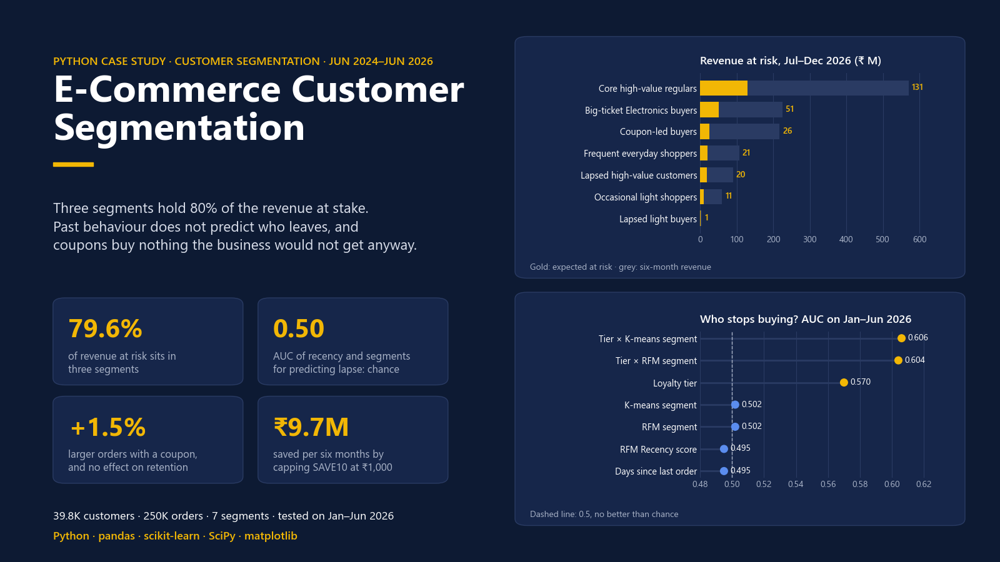
</p>

<p align="center">
<b>A K-means and RFM segmentation of 39,848 customers, tested against what they did next. Three segments hold 80% of the revenue at stake, past buying behaviour does not predict who stops buying, and coupons buy nothing the business would not have got anyway.</b>
</p>

<p align="center">


</p>

This is the follow-up to **[E-Commerce Sales Analytics](https://github.com/Vin-Okumu/e-commerce-sales-analytics)**, a Power BI case study on the same retailer. That project showed *where* revenue comes from. This one asks *which customers* drive it, which threaten it, and what to do about each group. It then tests every answer against later behaviour before recommending anything.

---

## At a glance

| Metric | Value | What it tells management |
|---|---|---|
| Customer segments | **7**, from K-means on 7 behavioural features | A shared language for marketing, CRM and leadership *[NB03]* |
| Top 3 segments | **54.7%** of customers, **79.3%** of revenue | Value is concentrated in Platinum-heavy, Electronics-heavy groups *[NB03]* |
| Revenue at risk, Jul–Dec 2026 | **₹261.2 M** expected, **79.6%** of it in the top 3 segments | Protecting the top three is where the next rupee belongs *[NB06]* |
| Predicting who stops buying | Recency, RFM and K-means: **AUC ≈ 0.50** (chance). Tier × segment: **0.606** | Recency-based win-back campaigns would not have found the customers who left *[NB04]* |
| Coupons | **+1.5%** order value, **no** effect on retention | Coupons subsidise customers who would buy anyway *[NB05]* |
| `SAVE10` capped at ₹1,000 | About **₹9.7 M** saved per six months | One pricing rule removes most coupon cost *[NB05, NB06]* |
| Cross-sell (Sports first) | **₹2.0–8.2 M** at 5%–20% take-up | Worth a trial, but cross-selling cannot fix the Electronics dependence *[NB05]* |

Source tags such as *[NB04]* point to the notebook that calculates each figure. *[Report §x]* points to the [first project's report](https://github.com/Vin-Okumu/e-commerce-sales-analytics/blob/main/02_documentation/analysis_report.md).

---

## 1. The problem

> *"We know Platinum customers bring in most of the money and that Electronics dominates. But who are our customers really, who is slipping away, are coupons worth it, and where should the next rupee of retention and marketing spend go?"*

The first project left these questions open. They are framed as six executive questions, each with its own objective, in the [analysis charter](02_documentation/analysis_charter.md):

| # | Executive question | Objective | Notebook |
|---|---|---|---|
| 1 | "Beyond Silver, Gold and Platinum, who are our customers really?" | Build a behaviour-based segmentation | NB02, NB03 |
| 2 | "Is our tier programme rewarding the right people?" | Test the loyalty tiers against real behaviour | NB04 |
| 3 | "Who is slipping away, how much revenue goes with them, and do customers get more valuable over time?" | Measure lapse risk and the revenue tied to it | NB04 |
| 4 | "Are coupons building loyalty, or subsidising people who would buy anyway?" | Judge whether coupons are worth what they cost | NB05 |
| 5 | "Which customers can help us depend less on Electronics?" | Find who can reduce the Electronics dependence | NB05 |
| 6 | "Where should the next rupee of retention and marketing spend go?" | Turn the segments into an action plan | NB06 |

## 2. The data

The same three processed tables as the first project, copied unchanged with checksums recorded in [`01_data/processed/README.md`](01_data/processed/README.md):

| Table | Rows | Grain |
|---|---|---|
| `Fact_Sales.csv` | 250,000 | One order |
| `Dim_Customers.csv` | 40,000 | One customer (tier, registration date, age group, state) |
| `Dim_Products.csv` | 2,000 | One product (category, brand, price) |

**Continuity check.** Before any new analysis, [`01_customer_features.ipynb`](03_analysis/01_customer_features.ipynb) reproduces all 12 headline figures published by the first project, including ₹1.41 bn revenue, 30,840 active customers and the 72.7% Electronics share.

**Testing on data the segments never saw.** The 25 months of orders are split so that segments built on the past can be checked against what customers did next:

| Window | Orders | Used for |
|---|---|---|
| Calibration | Jun 2024 – Dec 2025 | Build features and segments |
| Holdout | Jan – Jun 2026 | Check what those customers actually did |
| Full period | Jun 2024 – Jun 2026 | Describe customers as they are now, for the playbook |

## 3. Approach

```
Processed CSVs ──► Customer features ──► RFM baseline ──► K-means segments ──► Holdout tests ──► Coupons & cross-sell ──► Playbook
```

| Notebook | What it does |
|---|---|
| [`01_customer_features.ipynb`](03_analysis/01_customer_features.ipynb) | Continuity check, nine data questions, and one row per customer with Recency, Frequency, Monetary, AOV, coupon, payment and category features. Definitions are in the [feature dictionary](02_documentation/feature_dictionary.md) |
| [`02_rfm_baseline.ipynb`](03_analysis/02_rfm_baseline.ipynb) | Rule-based RFM scores and a 7-segment map, the benchmark K-means has to beat |
| [`03_kmeans_segmentation.ipynb`](03_analysis/03_kmeans_segmentation.ipynb) | Six feature-set versions compared, k chosen on inertia, silhouette, 50-resample bootstrap stability and business usefulness, then profiled and named by rule |
| [`04_validation_tier_and_holdout.ipynb`](03_analysis/04_validation_tier_and_holdout.ipynb) | Segments refitted on calibration data and tested on Jan–Jun 2026: lapse rates, cross-fitted AUC with bootstrap intervals, purchase gaps, cohorts and the loyalty tiers |
| [`05_coupons_and_cross_sell.ipynb`](03_analysis/05_coupons_and_cross_sell.ipynb) | Coupon cost, within-customer order-value test, coupon persistence, outcomes adjusted for tier and order count, category co-occurrence and the cross-sell opportunity |
| [`06_segment_playbook.ipynb`](03_analysis/06_segment_playbook.ipynb) | Segment cards, value-at-stake ranking, trial sizing and the CRM-ready customer file |

Shared rules (valid order statuses, time windows, feature definitions) live in [`customer_features.py`](03_analysis/customer_features.py), so every notebook builds customers the same way.

## 4. Results

### Who are the customers? *(Objective 1)*

<p align="center">
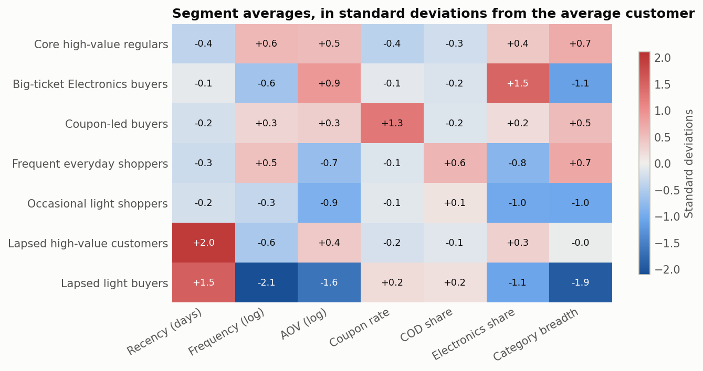
</p>

- **Seven segments**, separated mainly by *what* customers buy (category breadth, Electronics share, basket size) rather than *when* they last bought:

  | Segment | Customers | Revenue |
  |---|---|---|
  | Core high-value regulars | 27.9% | 44.6% |
  | Big-ticket Electronics buyers | 12.7% | 17.7% |
  | Coupon-led buyers | 14.1% | 17.0% |
  | Frequent everyday shoppers | 17.1% | 8.4% |
  | Occasional light shoppers | 15.2% | 4.7% |
  | Lapsed high-value customers | 8.0% | 7.1% |
  | Lapsed light buyers | 5.0% | 0.4% |

- **Structural limits:** The segments are weakly separated (silhouette 0.150) but very stable (mean ARI 0.952 across 50 resamples). They are consistent slices of a continuum, not natural groups.
- **K-means and RFM see customers differently** (ARI 0.099). K-means describes buying style; RFM describes recency and spend.

### Who is slipping away? *(Objective 3)*

<p align="center">
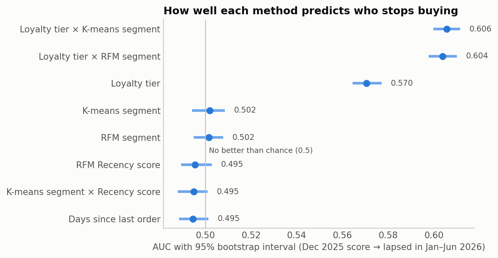
</p>

- 22.9% of customers placed no order in Jan–Jun 2026, and **every segment lapsed at about that rate (22%–24%)**.
- Recency, RFM and K-means segments **could not predict who would lapse** (AUC 0.495–0.502), but the loyalty tier could (0.570), and tier combined with segment did best (0.606) *[NB04]*.
- **No gap length marks a lapse:** Customers who had not ordered for over 209 days lapsed at 22.0%, against 23.1% for everyone else.
- **Value neither builds nor fades with tenure:** Spend per registered customer is flat across the 12 registration cohorts.

### Are the tiers right? *(Objective 2)*

- **Tier** tracks **spend (ρ = +0.764)**, not **recency (−0.126)**.
- **Customers whose behaviour did not match their tier behaved like their tier in 2026.** Under-tiered Silver customers spent ₹5,420 each, close to other Silver customers. Quiet Platinum customers came back and lapsed *less* than other Platinum customers (16.4% against 20.1%).
- On this evidence the tier programme is rewarding the right people: tier is a better guide to the next six months than past behaviour.

### Are coupons worth it? *(Objective 4)*

<p align="center">
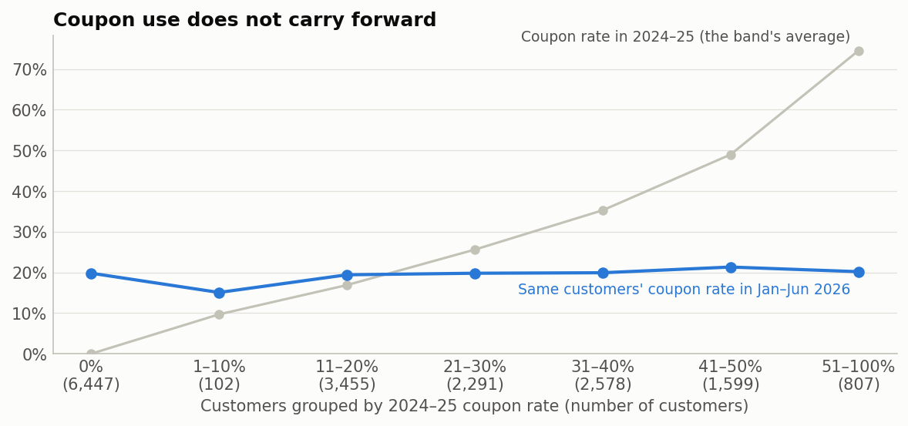
</p>

- Coupon orders are only **1.5% larger** than the same customers' other orders, and **coupon users lapse at the same rate** as non-users once tier and order count are accounted for.
- **Coupon use is not a habit.** Customers who used coupons on more than half their orders in 2024–25 used them on about 20% in 2026, the same as everyone else.
- **`SAVE10` (10% off) is 97.0% of coupon cost**, and 73.2% of that falls on Electronics orders. One order received a ₹41,092 discount.

### Who can reduce the Electronics dependence? *(Objective 5)*

- **4,992 Electronics-led customers (12.5%) hold ₹1,192.2 M (22.4%) of revenue**, and 93.7% of them are Platinum. They lapse no more often than mixed customers in the same tier.
- **Sports is the best next category.** Electronics buyers buy Home *less* often than chance (lift 0.63).
- **The opportunity is small:** ₹2.0–8.2 M at 5%–20% take-up, because an Electronics order is worth about four times a Sports order.

### Where should the next rupee go? *(Objective 6)*

<p align="center">
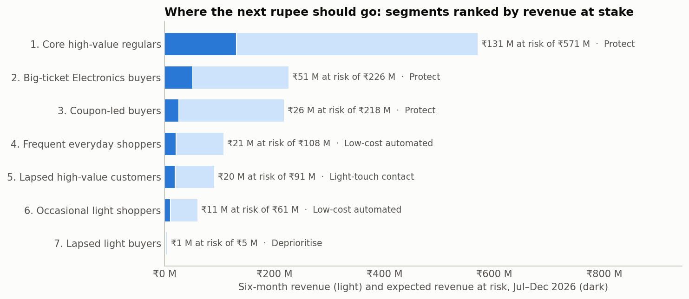
</p>

The full [segment playbook](04_report/segment_playbook.md) gives each segment a card covering value, behaviour, tier, lapse risk, coupons, cross-sell, the action and the KPI to track.

<details>
<summary><b>View more charts</b> (RFM grid, choosing k, PCA map, lapse by tier and segment, coupon cost, category lift)</summary>
<br>

**RFM grid** from [`02_rfm_baseline.ipynb`](03_analysis/02_rfm_baseline.ipynb)
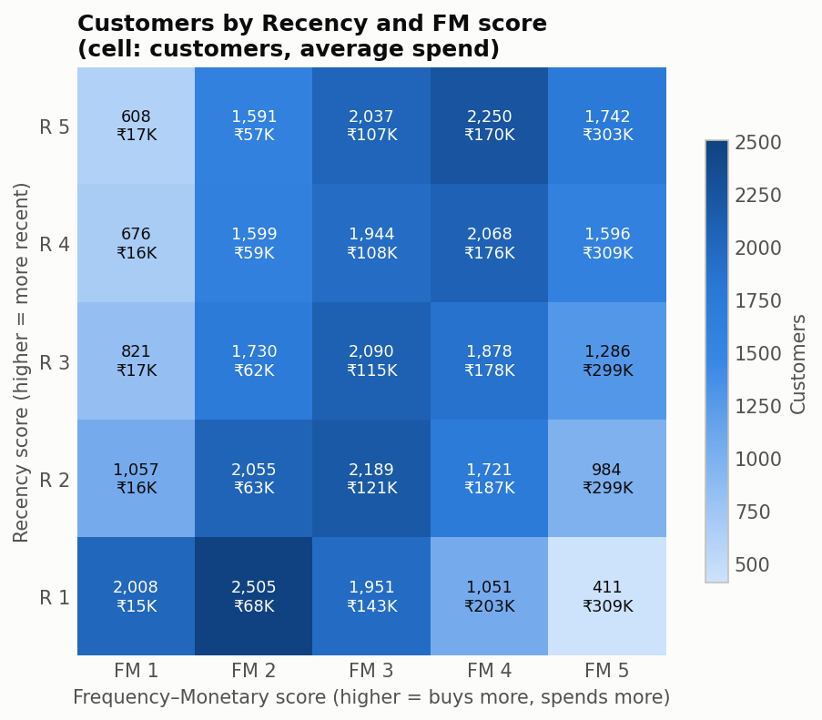

**Choosing the number of clusters** from[`03_kmeans_segmentation.ipynb`](03_analysis/03_kmeans_segmentation.ipynb)
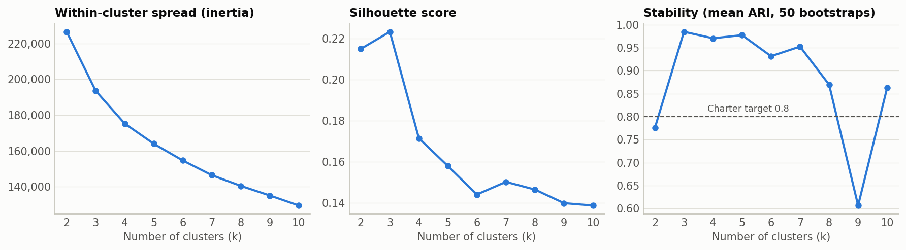

**The segments on two PCA dimensions** from [`03_kmeans_segmentation.ipynb`](03_analysis/03_kmeans_segmentation.ipynb)
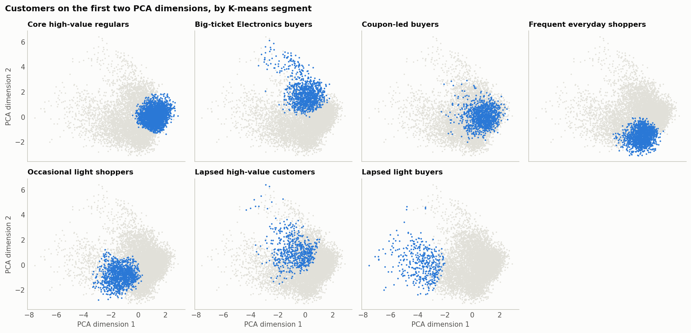

**Lapse rate by segment within each tier** from [`04_validation_tier_and_holdout.ipynb`](03_analysis/04_validation_tier_and_holdout.ipynb)
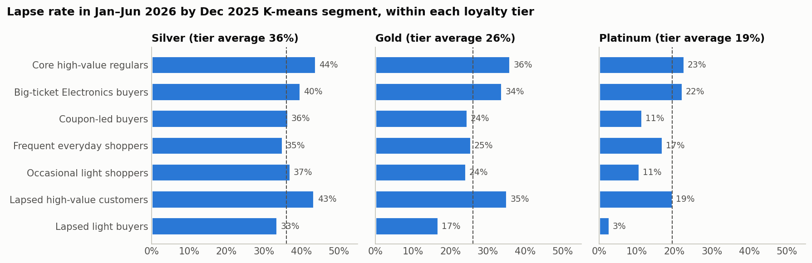

**Revenue and customers by segment and tier** from [`04_validation_tier_and_holdout.ipynb`](03_analysis/04_validation_tier_and_holdout.ipynb)
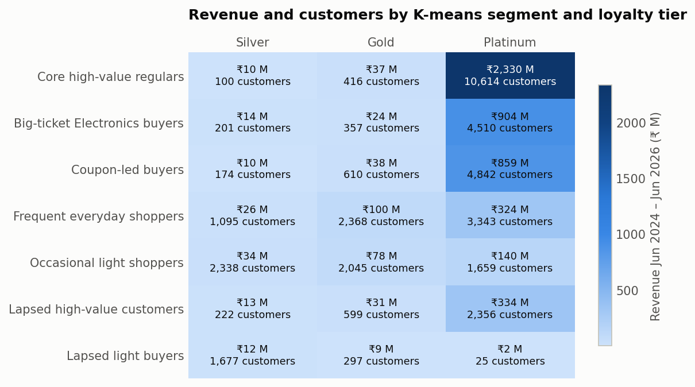

**Coupon cost by segment** *from [`05_coupons_and_cross_sell.ipynb`](03_analysis/05_coupons_and_cross_sell.ipynb)
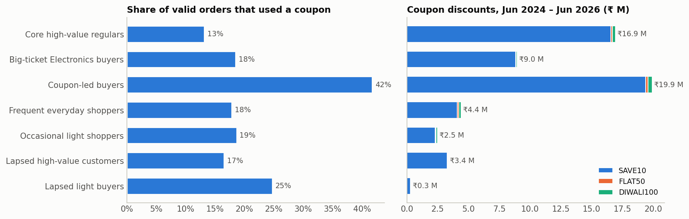

**Which categories share a customer** from [`05_coupons_and_cross_sell.ipynb`](03_analysis/05_coupons_and_cross_sell.ipynb)
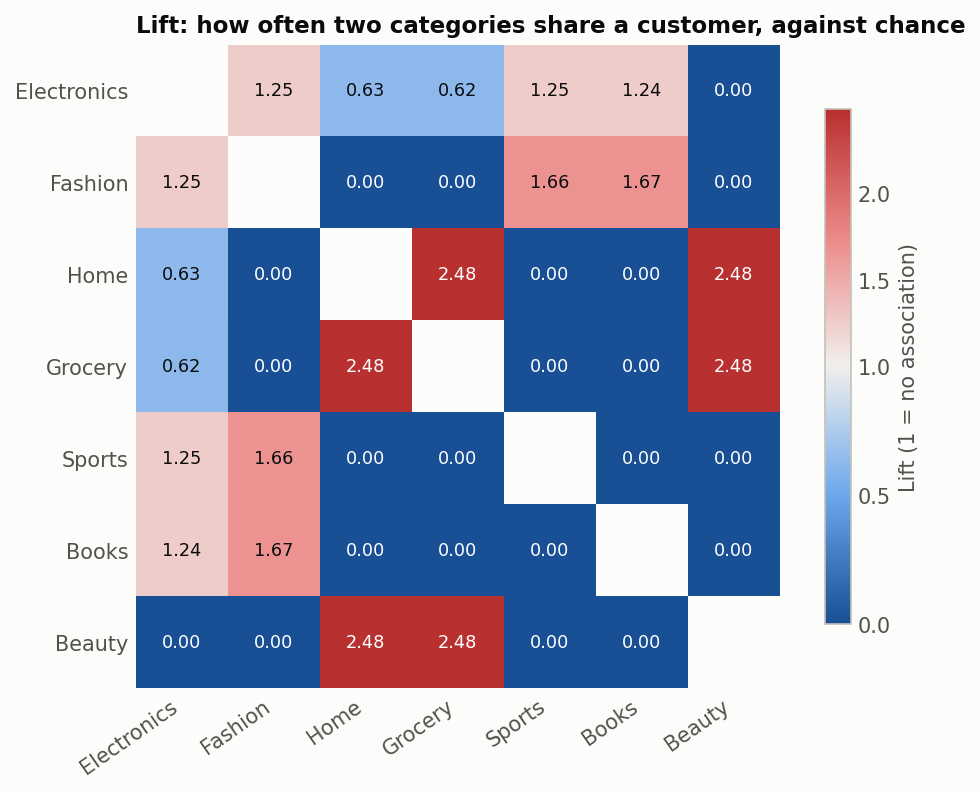

</details>

## 5. Recommendations

| # | Business question | Insight | Recommended action |
|---|---|---|---|
| 1 | Where should retention money go? | Three segments, almost all Platinum, hold ₹208.0 M of the ₹261.2 M at risk | **Protect them with service, not discounts:** priority service, early access to launches and recognition |
| 2 | Are coupons worth what they cost? | Coupons do not raise basket size or retention, and `SAVE10` is 97% of their cost | **Cap `SAVE10` at ₹1,000** for a random half of customers, then roll out if spend holds (about ₹9.7 M saved per six months) |
| 3 | Should we win back quiet customers? | Recency does not predict lapse, and quiet Platinum customers came back on their own | **Drop recency-triggered win-back.** Send one low-cost reminder to half of the 4,058 low-activity Platinum customers and measure the difference |
| 4 | Who can we cross-sell to? | 3,302 Electronics-led customers have room to add a category; Sports adds the most expected value | **Run a Sports-first cross-sell trial**, judged against the 16.1% who add Sports without a campaign |
| 5 | Should we change the tiers? | Under-tiered customers spent like their own tier in 2026 | **Keep the tier rules.** Test an upgrade incentive on a random half of the 1,858 candidates before changing anything |

Every action is framed as a **controlled trial**. NB06 sizes each one: the `SAVE10` cap trial could detect a 1.2-point change in lapse rate, and the smallest list-based trial a 6.1-point change. The customer file [`customer_segments.csv`](01_data/output/customer_segments.csv) carries each customer's segment, scores, expected lapse probability, action and list flags, ready for a CRM.

## 6. What this changes from the first project

| First project's recommendation *[Report §4]* | What this project found | Status |
|---|---|---|
| Win second orders from one-time buyers | 99.1% of Jan–Jun 2026 one-time buyers had ordered before; only 117 were genuinely new | **Revised:** the issue is established customers buying less often, not missing second orders |
| Protect Platinum, move Silver and Gold up | Tier predicts the next six months better than behaviour; under-tiered customers spent like their tier | **Protect confirmed; upgrades as a trial only** |
| Cross-sell Home and Sports to Electronics buyers | Sports is supported, Home is not (lift 0.63), and the total opportunity is small | **Revised:** Sports first, as a trial |

> **Notes on scope**
> - **Likely synthetic data.** The first project noted very even distributions *[Report §5]*. This project found more signs: lapse matches random ordering, coupon use behaves like chance on each order, and customers' categories follow four fixed patterns. On real data, recency and coupon habits would very likely matter more. The method (test segments on later behaviour before acting on them) would still apply.
> - **Revenue, not profit.** There is no cost-of-goods data.
> - **Associations, not proof of cause.** This is why each recommendation is a controlled trial.

---

## How to run

```bash
git clone https://github.com/Vin-Okumu/e-commerce-customer-segmentation.git
cd e-commerce-customer-segmentation
pip install -r requirements.txt
cd 03_analysis
jupyter notebook   # run 01 to 06 in order
```

- Each notebook reads the outputs of the ones before it from `01_data/output/`. The processed data is already in `01_data/processed/`.
- NB03 takes about 10 minutes because of the 50-resample stability check at each number of clusters. The other notebooks run in a minute or two.
- Built and tested with Python 3.13, pandas 3.0, scikit-learn 1.9, SciPy 1.18 and matplotlib 3.10.
- The cover image is rebuilt with `python make_cover.py` in `04_report/figures/` after the notebooks have run.

<details>
<summary><b>Repository structure</b></summary>

```
e-commerce-customer-segmentation/
├── 01_data/
│   ├── processed/                       # Fact_Sales, Dim_Customers, Dim_Products (from the first project, unchanged)
│   └── output/                          # Customer features, RFM scores, segments, lists and the CRM file
├── 02_documentation/
│   ├── analysis_charter.md              # Executive questions, objectives, metrics and plan
│   └── feature_dictionary.md            # Every customer feature and treatment decision
├── 03_analysis/
│   ├── customer_features.py             # Shared feature-building rules
│   ├── plot_style.py                    # Shared chart style
│   ├── 01_customer_features.ipynb
│   ├── 02_rfm_baseline.ipynb
│   ├── 03_kmeans_segmentation.ipynb
│   ├── 04_validation_tier_and_holdout.ipynb
│   ├── 05_coupons_and_cross_sell.ipynb
│   └── 06_segment_playbook.ipynb
├── 04_report/
│   ├── segment_playbook.md              # Executive summary and one card per segment
│   └── figures/                         # Cover, social preview and every notebook chart
├── requirements.txt
├── LICENSE
└── README.md
```
</details>

Have a similar project on your hands? Invite me to work on [Upwork](https://www.upwork.com/freelancers/uv23o9) · Reach out via [LinkedIn](https://www.linkedin.com/in/vince-okumu23/) · Or email me at vinny.otieno23@gmail.com

**Vincent Okumu**
